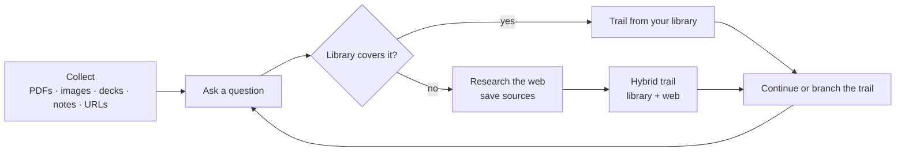

# memex.ai

**Ask questions of everything you've read, and follow the answer as a trail of cited passages.**

memex.ai is a research workspace inspired by Vannevar Bush's 1945 _memex_: a machine for recalling knowledge by association instead of by folder. You collect sources (PDFs, scans, slide decks, notes, web pages), ask a question, and get back a **trail**: an ordered path of passages from your own library, each with a verified quote, a short summary, and a note on why it leads to the next one. When your library doesn't cover a question, memex researches the web, saves what it finds, and blends it into the same trail with clear provenance.



## Features

- **Bring your own sources.** Upload PDFs and images (scanned pages are OCR'd in your browser and shown for review first), import PowerPoint decks with speaker notes, write or paste notes, or point it at a URL.
- **Trails, not chat.** Each answer is 3–8 ordered steps. Every step cites a real passage, shows a key quote that has been checked against the source text, gives a one-to-two sentence AI summary, and can expand to the full surrounding passage.
- **Library first, web when needed.** Questions are answered from your library when it has strong matches. Otherwise memex searches the web (Tavily), stores the pages as sources, and labels every step `In Your Library`, `Web Synthesized`, or `Hybrid`.
- **Links, not just lists.** Every connection between two passages is a saved link with a reason, shared by every trail that walks it. Open any passage to see what it's tied to and which trails pass through it, follow a link, or link it to another passage yourself.
- **Learn from others.** Share a trail on **Explore** (`/explore`) and browse the most-followed public trails. Each public step shows its note, summary, key quote, and source title, never your full private passages. "Ask in my library" rebuilds the same question from your own sources.
- **Edit the path.** Insert a passage anywhere, drop or reorder steps, and add your own notes. Claude suggests why each new connection holds, and you can reword it before saving. Start a side trail from any step to follow a tangent without losing the original.
- **Keep going.** Ask a follow-up to extend a trail, branch a new trail from any step, or revisit earlier trails from the trails drawer and command palette (`Ctrl/⌘ K`).
- **Private by default.** Every table, file, and search is scoped to the signed-in user with Postgres row-level security. No `service_role` key is used anywhere.

## Tech stack

| Layer | Choice |
| --- | --- |
| App | Next.js 16 (App Router, Turbopack, Cache Components), React 19, TypeScript |
| Styling | Tailwind CSS v4, Framer Motion |
| Auth, database, files | Supabase Auth, Postgres + pgvector, Storage (via `@supabase/ssr`) |
| Embeddings | Gemini `gemini-embedding-001`, 1536 dimensions |
| Trail writing | Claude `claude-sonnet-5-5`, falling back to `claude-haiku-5-5` when overloaded |
| Web research | Tavily search and extract |
| Document reading | pdf.js and Tesseract.js in the browser, `unpdf` on the server, `fflate` for `.pptx` |

## Quick start

**Prerequisites:** Node.js 20.9+, a [Supabase](https://supabase.com) project, a [Gemini API key](https://aistudio.google.com/app/apikey), and an [Anthropic API key](https://console.anthropic.com/settings/keys). A [Tavily key](https://tavily.com) is optional but needed for web research.

```bash
git clone https://github.com/Chojipargo/memex.git
cd memex
npm install
cp .env.example .env.local     # then fill in the keys (see Configuration)
npx supabase link --project-ref <your-project-ref>
npx supabase db push           # applies everything in supabase/migrations
npm run dev
```

Open <http://localhost:3000>, create an account, upload a document, and ask a question about it.

Without Supabase credentials the UI still renders, and auth, uploads, and trails show a setup message instead of crashing.

## Configuration

All keys except the two `NEXT_PUBLIC_` values are **server-only**. Never expose them to the browser.

| Variable | Required | Purpose |
| --- | --- | --- |
| `NEXT_PUBLIC_SUPABASE_URL` | Yes | Supabase project URL (Project Settings → API) |
| `NEXT_PUBLIC_SUPABASE_ANON_KEY` | Yes | Supabase anon key. Public by design; access is enforced by RLS |
| `GEMINI_API_KEY` | Yes | Embeddings for documents, notes, questions, and web pages |
| `ANTHROPIC_API_KEY` | Yes | Writing trails and continuations |
| `TAVILY_API_KEY` | For web research | Automatic web fallback and "Research the web". Library-only trails and pasted-URL extraction work without it |
| `TRAIL_COVERAGE_THRESHOLD` | No (`0.6`) | How strong a library match must be before skipping the web. Raise it to research more often |
| `TRAIL_STEP_WEIGHT` | No (`0.5`) | When continuing a trail, how much the next step is chosen for being near the current passage (`1`) versus matching the question (`0`) |
| `CLAUDE_TRAIL_MODEL` | No (`claude-sonnet-5-5`) | Model that writes trails |
| `CLAUDE_TRAIL_FALLBACK_MODEL` | No (`claude-haiku-5-5`) | Used when the main model is overloaded; `none` disables it |
| `GEMINI_EMBEDDING_MODEL` | No (`gemini-embedding-001`) | Embedding model |
| `EMBEDDING_DIMENSIONS` | No (`1536`) | Must match `vector(1536)` in the migrations; changing it means re-embedding everything |

> Supabase Auth uses the project URL and anon key, not the `postgresql://` connection string. That string is only for direct SQL clients; keep it in a server-only variable such as the commented `DATABASE_URL` in `.env.example`.

### Supabase setup

1. **Migrations:** `npx supabase db push` creates the tables, pgvector indexes, row-level security policies, RPC functions, and the private `documents` storage bucket (25 MB, PDF and image types). You can also paste the files in `supabase/migrations/` into the SQL editor in order.
2. **Redirect URLs:** Authentication → URL Configuration → add `http://localhost:3000/auth/callback` and your production `/auth/callback`. Needed for OAuth and password-reset emails.
3. **Google sign-in (optional):** Authentication → Providers → Google. Create a Google Cloud OAuth client whose redirect URI is `https://<your-project-ref>.supabase.co/auth/v1/callback`.

## What you can add

| Source | Where | How it's read |
| --- | --- | --- |
| PDF with a text layer | Upload → Upload document | Text read in the browser with pdf.js (server re-reads with `unpdf` as a fallback) |
| Scanned PDF or image (PNG, JPEG, WebP, BMP) | Upload → Upload document | OCR in the browser with Tesseract; you review and edit the text before it's saved |
| PowerPoint (`.pptx`) | Upload → Note or text → Import file | Slide text and speaker notes in slide order. Older `.ppt` files must be re-saved as `.pptx` |
| Text or Markdown file | Upload → Note or text → Import file | Imported into the note editor |
| Note | Upload → Note or text, or the hero's "Save as note" | Saved and embedded directly |
| Web page or topic | Research the web (hero, header, or command palette) | Fetched through Tavily, chunked, embedded, and saved as a web source |

Everything is split into overlapping ~500–800 token chunks and embedded, so it can be found by meaning rather than keywords.

## How it works

1. **Ingest.** Sources are chunked and embedded with Gemini, then stored in Postgres with pgvector, together with provenance (library or web, URL, domain, retrieval time).
2. **Retrieve.** A question is embedded and matched against your chunks by cosine similarity.
3. **Route.** If the best match clears `TRAIL_COVERAGE_THRESHOLD`, the trail is built from your library. Otherwise memex researches the web, saves the pages, and combines web and library passages.
4. **Write.** Claude orders the strongest passages into a trail, writing for each step a short note on why it follows, a gist, and a key quote. Output is validated on the server: unknown or duplicate citations are dropped, and a quote that can't be found in its passage is removed rather than shown.
5. **Save and stream.** The trail is saved atomically, and the UI shows live `searching → researching → weaving` progress while it's built.

Follow-ups work the same way, but stay anchored to where the trail currently ends, and the library-or-web decision is made on the follow-up question itself.

See [docs/architecture.md](docs/architecture.md) for the full pipeline, database schema, and API details.

## API

All routes require a signed-in session and return JSON errors (`401` when signed out).

| Route | Purpose |
| --- | --- |
| `POST /api/documents/upload` | Store a PDF or image and index its extracted text |
| `POST /api/documents/note` | Save and index a note |
| `POST /api/trails` | Build a trail. Body: `{ question, mode?: "auto" \| "research", url? }`. Streams NDJSON progress, then the trail |
| `GET /api/trails` | Your 50 most recent trails |
| `GET/POST/DELETE /api/trails/:id/publish` | Check, publish (or refresh), or unpublish a trail on Explore |
| `POST /api/trails/:id/rewrite/preview` | Preview an insert, drop, or reorder. Body: `{ chunkIds }`. Returns new connections with existing or Claude-suggested reasons |
| `POST /api/trails/:id/rewrite` | Apply it. Body: `{ expectedChunkIds, steps: [{ chunkId, reason?, reasonOrigin? }] }` |
| `POST /api/trails/:id/proposals` | Suggest alternative next steps from where a trail ends, each with a reason. Body: `{ question? }` |
| `POST /api/trails/:id/proposals/accept` | Continue with one. Body: `{ fromChunkId, chunkId, reason, reasonEdited, gist?, quote? }` |
| `PATCH /api/trails/:id/steps/:position` | Set or clear your annotation on a step |
| `POST /api/trails/:id/side-trails` | Start a side trail at a step. Body: `{ position }` |
| `GET /api/chunks/:id/backlinks` | Links tied to a passage and the trails that pass through it |
| `POST /api/links` | Link two of your passages by hand. Body: `{ sourceChunkId, targetChunkId, reason }` |
| `POST /api/links/:id/traverse` | Record that a link was followed |
| `GET /api/chunks/search?q=` | Semantic search over your passages |
| `POST /api/explore/:id/learn` | Count the signed-in reader as a learner of a public trail |
| `GET /api/trails/[id]` | One trail with its cited passages |
| `POST /api/trails/[id]/continue` | Append 2–4 steps for a follow-up question. Streams like `POST /api/trails` |
| `GET /api/chunks/[id]/context` | A cited passage with the passages before and after it |

Pages: `/sign-in`, `/sign-up`, `/forgot-password`, `/reset-password`, `/dashboard` (protected), and `/auth/callback` for OAuth and recovery links. `/` redirects to `/sign-in`.

## Project structure

```
src/
├─ app/
│  ├─ api/                 # documents, trails, chunks route handlers
│  ├─ auth/callback/       # OAuth and recovery code exchange
│  ├─ dashboard/           # workspace page and sign-out action
│  └─ sign-in, sign-up, forgot-password, reset-password/
├─ components/
│  ├─ art/                 # SVG backdrop artwork
│  ├─ auth/                # auth cards, fields, social sign-in
│  ├─ dashboard/           # workspace, hero, trail views, dialogs, command palette
│  ├─ documents/           # document uploader and OCR review
│  └─ ui/                  # icons, spinner
├─ lib/
│  ├─ dashboard/           # workspace types and per-user local cache
│  ├─ documents/           # browser extraction: PDF, OCR, PowerPoint
│  ├─ ingestion/           # chunking, embeddings, server PDF reading, limits
│  ├─ rag/                 # library-or-web routing, Tavily, web source storage
│  ├─ trails/              # trail generation, validation, quotes, persistence
│  └─ supabase/            # browser, server, and proxy clients
└─ proxy.ts                # session refresh and route protection (Next 16 "proxy")
supabase/migrations/       # schema, RLS, RPC functions, storage bucket
docs/architecture.md       # pipeline and schema deep dive
```

## Development

```bash
npm run dev     # dev server at http://localhost:3000
npm run build   # production build and type check
npm run lint    # ESLint
npm test        # unit tests (node:test) for quotes, URLs, provenance, PowerPoint parsing
npm start       # serve the production build
```

This project uses **Next.js 16**, which differs from older versions: route protection lives in `src/proxy.ts` (not `middleware.ts`), and Cache Components are on, so anything that reads the session must sit inside a `<Suspense>` boundary. Read `node_modules/next/dist/docs/` before changing framework-level code (see `AGENTS.md`).

## Troubleshooting

| Problem | Fix |
| --- | --- |
| Questions never use the web | Set `TAVILY_API_KEY` and restart. If your library is large, raise `TRAIL_COVERAGE_THRESHOLD` (for example `0.7`) |
| Web research runs too often | Lower `TRAIL_COVERAGE_THRESHOLD`, but keep it above ~0.55; unrelated text scores around 0.45–0.52 |
| "Supabase is not configured" | Fill in `NEXT_PUBLIC_SUPABASE_URL` and `NEXT_PUBLIC_SUPABASE_ANON_KEY` in `.env.local` and restart |
| Errors mentioning a missing table or function | Run `npx supabase db push` to apply the latest migrations |
| A `.ppt` file won't import | Open it in PowerPoint, save as `.pptx`, and import that |
| A deck imports with little text | Image-only slides have no text layer. Export them as PDF or images and upload those for OCR |
| Google sign-in or password reset fails | Add your `/auth/callback` URL to Supabase's redirect allowlist |

## License

[MIT](LICENSE) © 2026 Joseph Uzoigwe
