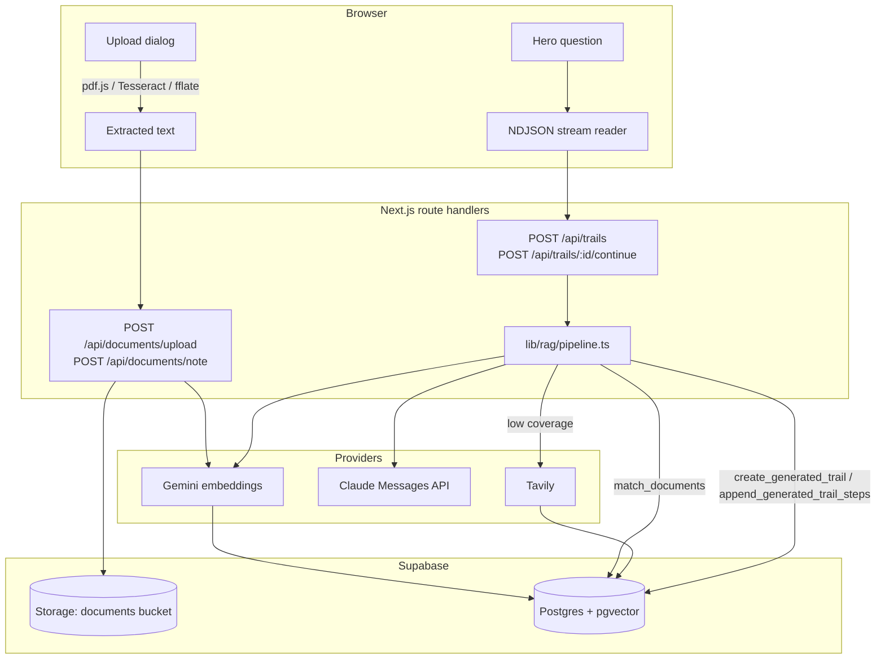

# Architecture

How memex.ai turns sources into trails. For setup and usage, see the [README](../README.md).

## Overview

All Supabase access uses the signed-in user's session (`@supabase/ssr`), so row-level security applies to every query and RPC. No `service_role` key exists in the app.

## Ingestion

### Documents (`POST /api/documents/upload`)

Text is extracted **in the browser** before upload (`src/lib/documents/extract.ts`):

- **PDFs:** pdf.js reads the text layer page by page. Pages without usable text are rendered and OCR'd with Tesseract.js.
- **Images:** OCR'd with Tesseract.js.
- The user reviews and can edit the extracted text in the OCR review dialog before saving.

The route receives `multipart/form-data` with `file`, `extractedText`, `pageTexts`, `pageCount`, `extractionMethod`, optional `title`, and optional `trailId`. It then:

1. **Validates** the type by file signature (`%PDF-`, PNG/JPEG/WebP/BMP magic bytes), the size (25 MB), and the extracted text (5 MB).
2. **Stores** the original at `<user-id>/<document-id>.<ext>` in the private `documents` bucket and inserts the `documents` row with extraction metadata.
3. **Falls back** to server-side `unpdf` extraction for PDFs when the browser sent no text.
4. **Chunks** the pages (`src/lib/ingestion/chunk.ts`): sentence-aware windows of 500–800 cl100k_base tokens with 100 tokens of overlap. A chunk can span pages and is attributed to the page that contributes most tokens.
5. **Embeds** chunks with Gemini `gemini-embedding-001` (`RETRIEVAL_DOCUMENT`, 1536 dimensions) in batches of 64, retrying rate limits and transient errors, and L2-normalizes the vectors.
6. **Indexes** the vectors into `chunks` in batches of 100. All embeddings are generated before any chunk rows are written.

If any step fails, the stored file and the document row are rolled back.

### Notes and PowerPoint (`POST /api/documents/note`)

Notes are JSON `{ title, content }` (1 MB) and go through the same chunk → embed → index steps without a storage upload.

PowerPoint decks are converted to note text in the browser (`src/lib/documents/pptx.ts`): the `.pptx` zip is opened with `fflate`, only slide and notes-slide parts are decompressed, slides are ordered by `ppt/presentation.xml`, and each slide's text and speaker notes are emitted with slide-number, date, and footer placeholders skipped. Legacy binary `.ppt` files are refused with instructions to re-save as `.pptx`.

### Web sources (`src/lib/rag`)

`web.ts` calls Tavily search (or extract, for a pasted URL). When Tavily is unavailable or can't read a pasted URL, the server fetches it directly, with two layers of protection against reaching internal services:

- `url.ts` rejects non-public hosts syntactically: private, loopback, link-local, CGNAT, multicast, and reserved IPv4 ranges in any spelling the URL parser accepts (decimal, hex, octal); IPv6 forms including `::`, `::1`, IPv4-mapped, NAT64, and 6to4 addresses that embed a private IPv4; single-label names; and local suffixes such as `.localhost`, `.local`, and `.internal` (trailing dots included).
- `safe-fetch.ts` replaces the socket's DNS lookup with one that rejects the host if any resolved address is non-public, and connects to the checked address. That covers public domains that point at private IPs and DNS rebinding. Redirects are followed by hand and every hop is checked again. Bodies are capped at 2 MB after decompression.

`ingest.ts` chunks and embeds the page text and saves it as a `source_kind = 'web'` document, deduplicated by a hash of the canonical URL, so later questions can find it without going back to the web. Every web passage is scored by its real cosine similarity to the question; for a page saved earlier, its stored chunks are re-scored and the best matches used.

Web research gets its own budget of up to 20 seconds, carved out of the route deadline while keeping 18 seconds for generation. Tavily calls, direct fetches, and embeddings all use that budget, so a slow URL produces a clear "ran out of time" error instead of the platform killing the request.

## Trail generation

### New trails (`POST /api/trails`)

Body: `{ "question": string, "mode"?: "auto" | "research", "url"?: string }`.

`buildHybridTrail` in `src/lib/rag/pipeline.ts`:

1. Embeds the question (`RETRIEVAL_QUERY`) and retrieves the top 30 chunks with `match_documents`.
2. **Auto mode:** if the best similarity is at least `TRAIL_COVERAGE_THRESHOLD` (default `0.6`), it builds from the library alone. Gemini scores unrelated text around 0.45–0.52 and on-topic text around 0.65+, so the threshold must stay above that noise floor.
3. Otherwise, or in **research mode**, it researches the web. Only library passages that clear the coverage threshold are blended in (so an automatic fallback is web-only, and research mode keeps your genuinely relevant passages). Web and library passages are ranked together by similarity, and the top 30 go to the model. A trail is labelled `Hybrid` only when the candidates really mix both.
4. Claude (`src/lib/trails/generate.ts`) receives the candidates, each labelled with its source and treated as untrusted data, and returns structured JSON for 3–8 ordered steps: chunk id, note on why it follows, gist, and key quote.
5. The server validates the response: unknown and duplicate chunk ids are dropped, notes are capped at 280 characters, and a response with fewer than 3 usable steps is retried once before returning `502`. If the main model is overloaded (429/5xx), the fallback model is used.
6. `create_generated_trail` saves the trail and steps atomically after checking that every cited chunk belongs to the caller.

### Continuations (`POST /api/trails/[id]/continue`)

Body: `{ "question": string }` (3–500 characters).

`buildHybridContinuation` runs two searches in parallel, both excluding chunks already on the trail:

- an **anchored** search on the follow-up plus the last step's note and excerpt, so the continuation stays connected to where the trail ends;
- a **direct** search on the follow-up alone.

Coverage is judged on the direct search only. The anchored query embeds a passage that is already in the library, so its neighbours always score highly and would otherwise hide that the library knows nothing about the follow-up. When the library doesn't cover it, the web search query includes the trail title for context, and passages are scored against the follow-up itself. Claude then writes 2–4 steps whose first note bridges from the current last step, and `append_generated_trail_steps` appends them under an advisory lock on the trail.

### Streaming

Both trail routes stream NDJSON (`src/lib/trails/responses.ts`): `status` events with stage `searching`, `researching`, or `weaving`, then a single `trail` or `error` event. `src/lib/trails/api.ts` parses the stream in the browser. Route `maxDuration` is 60 seconds, and `src/lib/trails/timeouts.ts` budgets embedding, research, and generation within it.

### Step digests and citations

- **Key quote:** `locateQuote` (`src/lib/trails/quote.ts`) finds the model's quote in the chunk after normalizing whitespace, quote marks, dashes, and soft hyphens. A missing or ambiguous quote is dropped and the step kept. Offsets are stored in code points, matching Postgres.
- **Gist:** a 1–2 sentence summary grounded only in that passage.
- **Full passage:** `GET /api/chunks/[id]/context` returns the chunk with its previous and next chunks via `get_chunk_neighbors`, with the overlap removed at each seam.
- **Provenance:** each step carries `sourceOrigin` (`library` or `web`), URL, domain, provider, and retrieval time. A trail is `Hybrid` when its steps mix both.

## Database

Migrations in `supabase/migrations/`, applied in order:

| Migration | Adds |
| --- | --- |
| `20261109130000_documents_chunks.sql` | `vector` extension, `documents`, `chunks` (`vector(1536)`, HNSW cosine index), RLS, private `documents` bucket |
| `20261109160000_ocr_trail_nodes.sql` | OCR metadata, hand-built `trail_nodes`, image types in the bucket |
| `20261109170000_generated_trails.sql` | `trails`, `trail_steps`, `match_chunks`, `create_generated_trail` |
| `20261110090000_append_trail_steps.sql` | `append_generated_trail_steps` |
| `20261110120000_trail_step_digest.sql` | `gist`, `quote_start`, `quote_end` on steps; `get_chunk_neighbors` |
| `20261111120000_hybrid_rag.sql` | Source provenance columns on `documents`; `match_documents` |
| `20261113120000_match_documents_recall.sql` | Wider (`ef_search` 400) and, on pgvector 0.8+, iterative HNSW scans in `match_documents`, so filtering to the caller's rows doesn't starve results when many users share the index |
| `20261113150000_published_trails.sql` | `published_trails` (public trail snapshots), `published_trail_learners`, and the `publish_trail` / `unpublish_trail` / `get_trail_publication` / `record_trail_learner` functions |
| `20261114090000_associative_links.sql` | `links` table; `link_id` and `annotation` on `trail_steps`; converts existing trails into links; `link_trail_steps`, `create_user_link`, `record_link_traversal`, `get_passage_backlinks` |
| `20261114120000_trail_editing.sql` | `parent_trail_id`, `branch_from_step_id`, `updated_at` on `trails`; `rewrite_trail` and `start_side_trail`; drops the retired `trail_nodes` table and its functions |

Every private table has owner-scoped RLS (`user_id = auth.uid()`, or through the owning document for `chunks`). The RPC functions are `security invoker` and check ownership of the trail and every cited chunk themselves. The exception is published trails (below).

## Associative links

A **link** (`public.links`) joins two of a user's passages and says why they connect. It is stored once, in reading order (`source_chunk_id → target_chunk_id`, unique per user and pair), and queried from either end. `origin` is `user` for links made by hand and `claude_accepted` for links Claude wrote that the user kept; generated trails count as accepted. Claude's unaccepted suggestions are never stored.

A trail is a chain of passages joined by links: every `trail_steps` row after the first has `link_id`, the link from the previous step's passage. `create_generated_trail` and `append_generated_trail_steps` call `link_trail_steps`, which reuses an existing link for the same pair (keeping its reason) or creates one from the step's note. The API returns the link's reason as each step's `note`, falling back to the legacy column. `annotation` is the reader's own note on a step, separate from the reason.

- `GET /api/chunks/[id]/backlinks` (`get_passage_backlinks`): the passage's links in both directions, with the passage at the other end, and every trail through it with the steps before and after.
- `POST /api/links`: `{ sourceChunkId, targetChunkId, reason }` makes a `user` link, or re-words an existing one.
- `POST /api/links/[id]/traverse`: increments `traversal_count` and sets `last_traversed_at` when a reader follows a link.
- `GET /api/chunks/search?q=`: semantic search over the caller's passages, used to pick a link target.

The passage drawer shows these in its **Also on these trails / Tied to these passages** panel.

## Editing trails and side trails

Every insert, drop, and reorder is a new order of passages applied by `rewrite_trail`, which:

- refuses the edit if the trail changed since the reader loaded it (`expectedChunkIds`, returned as `409`);
- keeps the gist, quote, and annotation of every step that stays, and deletes dropped steps (their links remain, since other trails may use them);
- gives every step after the first the link from the step before it, reusing an existing link for the pair, and requires a reason for any pair that has none yet.

Edits are previewed first (`POST /api/trails/[id]/rewrite/preview` with the new `chunkIds`). The preview lists each connection the edit would create, with the existing link's reason or, where none exists, a reason Claude suggests (`suggestLinkReasons` in `src/lib/trails/generate.ts`). The reader can edit any reason before applying with `POST /api/trails/[id]/rewrite`. A suggestion kept unchanged is saved as `claude_accepted`, and anything the reader wrote or changed as `user`. Unaccepted suggestions are never stored.

- `PATCH /api/trails/[id]/steps/[position]` sets or clears the reader's annotation on a step.
- `POST /api/trails/[id]/side-trails` with `{ position }` starts a new trail at that step (`start_side_trail`), recording `parent_trail_id` and `branch_from_step_id`. The dashboard opens it with the follow-up box focused.

Hand-built, document-level trails (`trail_nodes`) and the demo notes and trails are gone. The local cache keeps only generated trails.

## Public trails (Explore)

`/explore` lists trails readers have chosen to share, most-learned first (`?sort=recent` for newest), and `/explore/[id]` shows one. Both pages work signed out.

- **Publishing** (`POST /api/trails/[id]/publish`, `DELETE` to unpublish, `GET` for status) is opt-in per trail from the trail dialog's "Share on Explore" button. It stores a **snapshot** in `published_trails.steps`: each step's note, gist, verified key quote, source title and page, and, for web sources only, the URL and domain. Full passages of uploads and notes are never copied, and no policy on `documents` or `chunks` is loosened. Continuing a trail doesn't change its public copy until the owner chooses "Update public copy".
- **Popularity** is `learner_count`: the number of distinct signed-in readers, other than the author, who opened the trail (`POST /api/explore/[id]/learn`). Which readers opened a trail is never exposed, only the count.
- **Writes** go through `security definer` functions that check `auth.uid()` themselves. `published_trails` is select-only for `anon` and `authenticated`, and `published_trail_learners` has no grants at all, so clients can't forge a snapshot or inflate a count through PostgREST.
- **"Ask in my library"** links to `/dashboard?ask=<question>`. The dashboard builds that trail from the reader's own sources once the workspace loads, then strips the parameters from the URL.

If you change `EMBEDDING_DIMENSIONS`, update `vector(1536)` in the migrations and re-embed all documents. `gemini-embedding-001` supports 128–3072 dimensions.

## Client workspace

The dashboard (`src/components/dashboard/dashboard-workspace.tsx`) keeps notes and trails in React state and caches them in `localStorage` under `memex.workspace.v2:<user-id>`, so each account on a shared browser has its own cache. The cache is only read after the signed-in user is confirmed with Supabase. Note and document bodies are cached as previews of up to 20,000 characters (the full text is in the library); if the browser's storage quota is still exceeded, the workspace is saved with 2,000-character previews, and the user is told if even that fails. Generated trails are always reloadable from `GET /api/trails`.

## Auth and routing

`src/proxy.ts` (Next 16's replacement for `middleware.ts`) refreshes the Supabase session cookie on matched requests and protects `/dashboard`. API routes check the session themselves and return JSON `401`s. Cache Components is enabled, so session-dependent UI such as the account email and the document library sits inside `<Suspense>` boundaries while the rest of the page prerenders.
